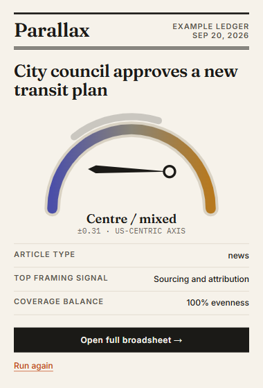
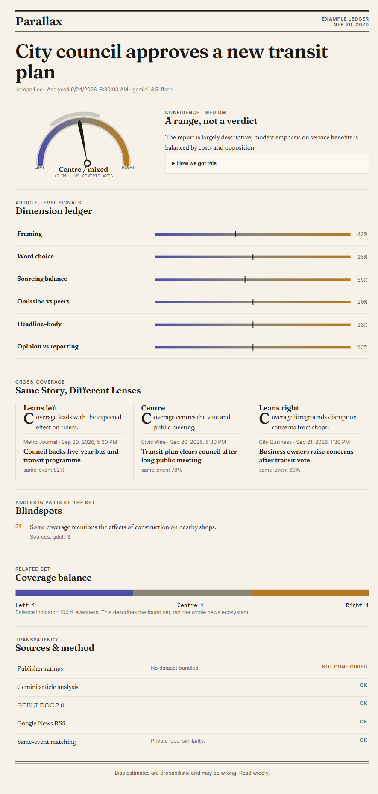
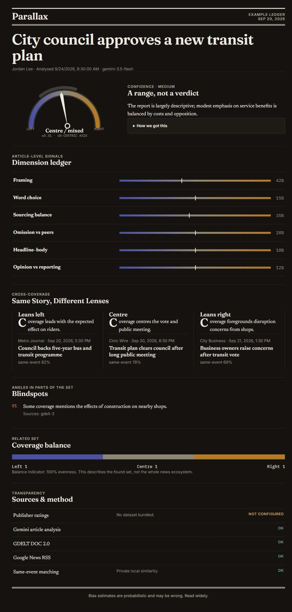
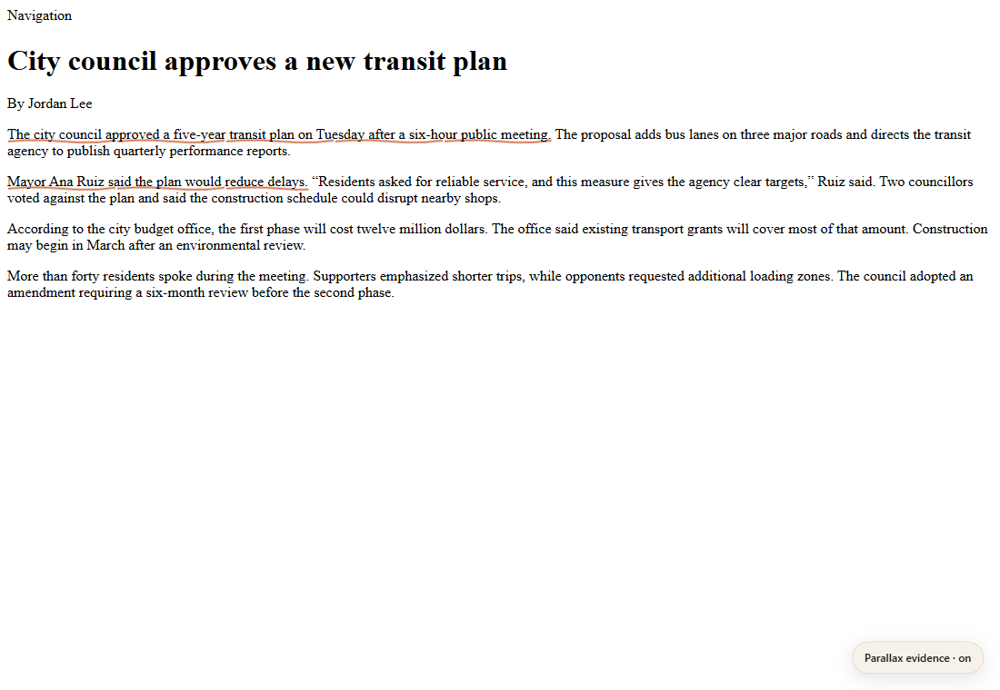
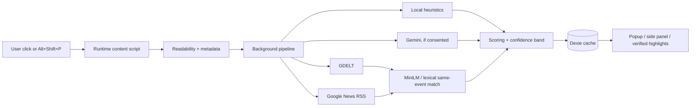

# Parallax

**See one story through more than one lens.**

Parallax is a Chrome and Firefox Manifest V3 extension that reads a news article only when asked, estimates its US-centric ideological lean and framing as a range rather than a verdict, verifies every quoted evidence span against the extracted text, and finds independent coverage of the same event. It works in a clearly labelled local heuristic mode without an API key and adds structured article-level analysis with a user-supplied free-tier Gemini key.

These are captures of the built extension and compiled content script from this session, not design mockups.

| Quick Read | Broadsheet · Newsprint |
|---|---|
|  |  |

| Broadsheet · Nightpress | Verified in-page evidence |
|---|---|
|  |  |

## Features

- Runtime-only Readability extraction under `activeTab`; no persistent host access to arbitrary pages.
- Local lexical signals plus structured Gemini analysis with Zod validation and prompt-injection boundaries.
- Programmatic rejection of non-verbatim evidence spans.
- GDELT DOC 2.0 and Google News RSS discovery with timeouts, canonical/title deduplication, and same-event filtering.
- Private MiniLM embeddings in a Chrome offscreen document, with a deterministic private lexical fallback for Firefox or model-load failures.
- Imported publisher priors kept separate from article-level signals; no ratings dataset is bundled.
- A score range that widens for missing inputs, thin evidence, and disagreement.
- Newsprint and Nightpress themes, reduced motion, keyboard navigation, responsive coverage tabs, and a Shadow DOM evidence overlay.
- IndexedDB caching with configurable TTL and one-click removal of the key, ratings, and cached results.

## How it works



The live pipeline stages are Reading article → Checking publisher → Analysing framing → Finding other coverage → Comparing lenses → Setting type. The Prism Split animation advances only when the background worker emits one of those events.

### Scoring and uncertainty

When all inputs exist, the point estimate is:

```text
lean = 0.30 × publisher prior + 0.55 × Gemini article signal + 0.15 × local heuristic
```

Missing weights are renormalised, never treated as evidence of neutrality. The initial half-width is `0.12`; it increases by `0.13` without a publisher prior, `0.20` without verified article analysis, up to `0.125` for thin evidence, and `0.22 × signal range` for disagreement. It is clamped to `0.12…0.65`. With neither a prior nor verified model evidence and weak heuristics, the UI says **INSUFFICIENT SIGNAL**.

### Evidence verification

Gemini must return exact contiguous spans. Parallax collapses whitespace in both the source and candidate span, retains only spans found in the extracted article, and records how many were removed. Fabricated or paraphrased spans never reach the ledger or page highlighter.

## Technology and licences

All versions are exact pins in `package.json` and `package-lock.json`.

| Component | Version | Licence |
|---|---:|---|
| WXT / React / Vite / TypeScript | 0.21.4 / 19.3.0 / 8.3.0 / 6.0.3 | MIT / MIT / MIT / Apache-2.0 |
| Motion / Tailwind CSS / Radix UI | 13.4.2 / 4.3.3 / exact package pins | MIT |
| Zustand / TanStack Query / Zod | 5.0.15 / 5.103.2 / 4.6.5 | MIT |
| Mozilla Readability / Dexie | 0.6.0 / 4.4.6 | Apache-2.0 |
| Google Gen AI SDK / Transformers.js | 2.24.0 / 4.3.0 | Apache-2.0 |
| D3 scale + shape / fast-xml-parser | 4.0.2 + 3.2.0 / 5.11.1 | ISC / MIT |
| Fraunces / Newsreader / Inter / IBM Plex Mono | 5.3.0 font packages | SIL Open Font License 1.1 |

See each package distribution for its authoritative licence text.

## Data sources

| Source | Key | Window | Use and limitations | Licence / attribution |
|---|---|---|---|---|
| Gemini Developer API | User key | Current article | Structured analysis; free-tier quota and data-use terms apply | Google API terms; article text is transmitted only after consent |
| GDELT DOC 2.0 | None | ±2 days | Public web-news index; incomplete and availability varies | GDELT Project attribution; publisher content remains its owners’ |
| Google News RSS | None | 2 days | Headline, publisher, time, URL, and snippet discovery; results vary by locale | Google service terms; linked content remains its publisher’s |
| MiniLM (`Xenova/all-MiniLM-L6-v2`) | None | Found set | Model is downloaded once from Hugging Face; matching then runs locally | Model-card licence must be reviewed for deployment |
| Publisher ratings | User import | N/A | Optional prior only; never presented as article truth | No dataset bundled; the imported file must state its source and licence |
| Article Bias Prediction mirror | None | Evaluation only | 223 MB; article labels still have source/collection caveats | Mirror declares Apache-2.0; derived from Baly et al. (2020) |
| MBIC | None | Evaluation alternative | Sentence-level bias, not a left/right article label | CC BY 4.0, DOI 10.5281/zenodo.4635121 |
| NewsWCL50 | None | Evaluation alternative | Word-choice annotations; original articles not redistributed | CC BY-SA 4.0 |

No Media Bias/Fact Check, AllSides, or Ad Fontes ratings are bundled because redistribution permission was not established for this project. Publisher priors therefore show **NOT AVAILABLE** until a user imports a compatible dataset.

## Prism Broadsheet design

The interface treats a broadsheet as light refracted through a prism: newsprint texture, double masthead rules, Fraunces display type, Newsreader editorial text, Inter UI labels, and IBM Plex Mono metrics. The non-partisan spectrum is indigo `#4B4FA8` → slate `#8A8577` → ochre `#B7791F`; colour is always paired with a text label and never uses party red/blue. Newsprint and Nightpress tokens meet the intended AA contrast targets. Focus rings are 2 px blue with offset, layouts survive 200% zoom, and animations follow `prefers-reduced-motion` through Motion’s `reducedMotion="user"`.

## Setup

Prerequisites: Node.js 22+, npm 10+, Chrome 120+ or Firefox 140+.

1. Create a free Gemini key in [Google AI Studio](https://aistudio.google.com/app/apikey). Do not put it in a source file or `.env`.
2. Install and build:

   ```bash
   npm ci
   npm run build:all
   ```

3. Chrome: open `chrome://extensions`, enable Developer mode, choose **Load unpacked**, and select `.output/chrome-mv3`.
4. Firefox: open `about:debugging#/runtime/this-firefox`, choose **Load Temporary Add-on**, and select `.output/firefox-mv3/manifest.json`.
5. Open Parallax Settings, paste and test the key, review consent, then save.

Development commands:

```bash
npm run dev             # Chrome MV3
npm run dev:firefox     # Firefox MV3
npm run build:all
npm run zip
npm run lint && npm run typecheck && npm test
```

## Usage

Open a news article and click the Parallax toolbar icon, or press `Alt+Shift+P`. The popup provides a Quick Read; **Open full broadsheet** opens the long-form view. Expand a dimension, then use **Show on page** to scroll to and pulse a verified evidence span. The floating page pill turns highlights on or off.

## Privacy

- `activeTab` and `scripting`: read only the page the user explicitly analyses.
- `storage`: keep consent, settings, the Gemini key, imported ratings, and results locally; the key is never synced or logged.
- `sidePanel` (Chrome): show the Broadsheet.
- `offscreen` (Chrome): run local embedding inference without page access.
- Host access is limited to Gemini, GDELT, Google News RSS, and the Hugging Face model download hosts.
- Article text goes to Gemini only with both consent and a configured key. On the free tier, Google states submitted data may be used to improve products.
- Search terms derived from the headline go to GDELT and Google News RSS.
- There is no analytics, advertising, account, or tracking identifier.
- **Clear key & all local data** removes the key, imported ratings, active result, and Dexie cache in one action.

## Evaluation

The harness is documented in [`evaluation/README.md`](evaluation/README.md). **No headline metrics are published yet:** this session did not have a user-provided Gemini key or a local licensed corpus, so producing four-way results would have required fabricating data or consuming an unapproved key. The runner writes actual accuracy, macro-F1, 3×3 confusion matrices, and hallucinated-evidence rate only from supplied/cached predictions. It uses a deterministic sample of at most 150 items per class.

```bash
npm run eval -- evaluation/dataset.jsonl
```

## Verification status

In this build session, `tsc --noEmit` passed, 13 unit/component tests passed, and both Chrome MV3 and Firefox MV3 production builds completed. Browser loading, live three-publisher analysis, screenshots, keyboard/reduced-motion/200%-zoom review, and full Gemini evaluation require interactive browser consent and a user-supplied key and are not claimed complete here.

## Limitations

Bias is contested, contextual, and multidimensional. The lean axis is US-centric. Publisher labels can hide article-level variation. Search indexes are incomplete and may return stale or syndicated copies. Headline/snippet comparisons cannot prove omission from full articles. Gemini may fail, disagree with readers, or hit free-tier limits. Paywalled article bodies are never scraped for comparison. Firefox currently falls back to local lexical same-event matching because Chrome’s offscreen-document API has no direct Firefox equivalent.

## Roadmap

- Complete the fixed-corpus Gemini evaluation and calibration study after a key is supplied.
- Add a Firefox worker-hosted MiniLM path and optional Gemini embeddings fallback.
- Add more licensed extraction fixtures and a fully mocked end-to-end article/highlight scenario.
- Add screenshot regression checks across additional viewport sizes.

## Contributing

Keep dependencies pinned, preserve strict TypeScript, add a fixture/test for extractor or parser changes, and never commit keys or copied paywalled article bodies. Run lint, typecheck, tests, and both MV3 builds before opening a change.

## Ethics and disclaimer

Parallax is a reading aid, not an arbiter of truth or a ranking of publishers. It separates outlet priors from article evidence, exposes uncertainty and provenance, and never treats colour as a verdict. **Bias estimates are probabilistic and may be wrong. Read widely.**

Released under the [MIT License](LICENSE).
